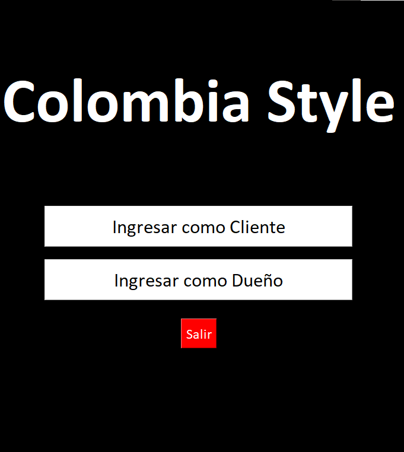
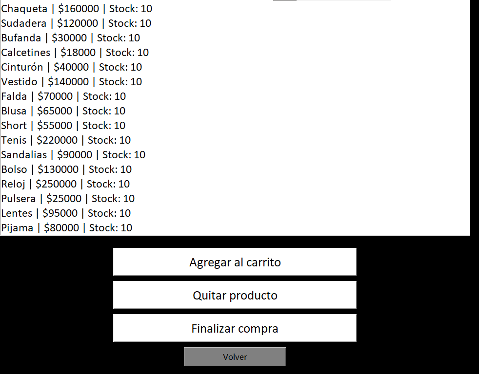
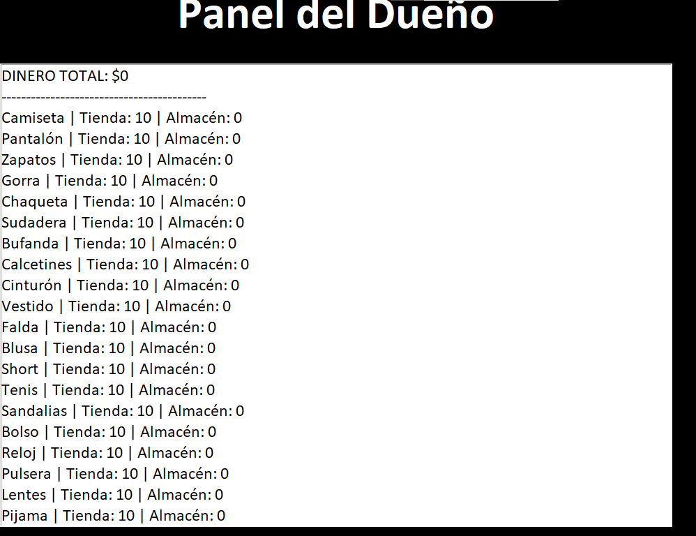

# Colombia Style — Retail Store Management System (Python)

GUI-based store and sales application developed in Python as a first-semester Systems Engineering project and presented at the **ExposanBuena 2026-I** academic showcase at Universidad de San Buenaventura.

## Key Features
- **Role-Based Interface:** Separate workflows for **Customers** (*Ingresar como Cliente*) to browse products and calculate purchases, and **Store Owners** (*Ingresar como Dueño*) to manage store items.
- **Automated Billing Logic:** Real-time calculation of item subtotals, purchase totals, and order summaries.
- **Structured Program Flow:** Event-driven interface logic paired with conditionals, loops, and data structures to handle user interactions cleanly.

## Application Preview

### Main Role Selection Screen

### Customer View

### Owner View

## Project Evolution
This project served as the functional prototype for my later object-oriented desktop application in Java/JavaFX (**[ColombiaStyle JavaFX](https://github.com/miguelangelhuertasarchila-netizen/store-management-system-java)**), demonstrating progression from initial GUI scripting in Python to modular OOP with Maven.

## Technologies
- Python 3
- Tkinter (Graphical User Interface)
